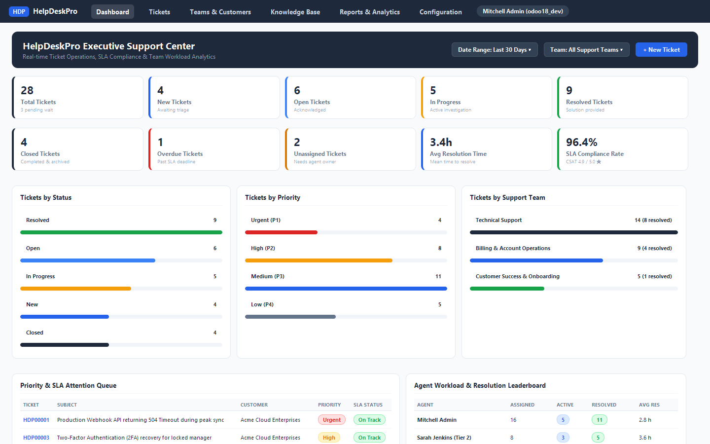
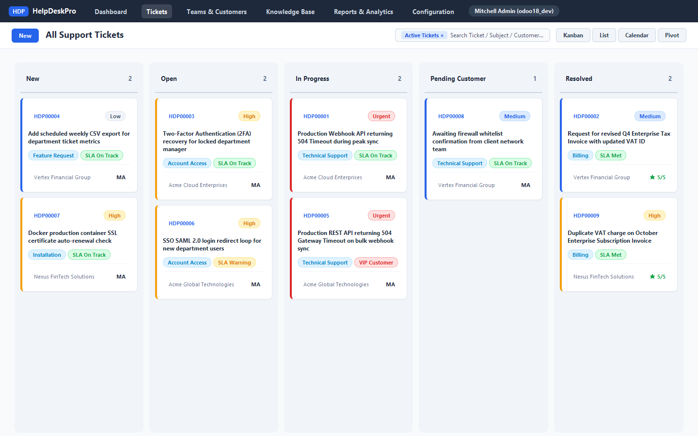
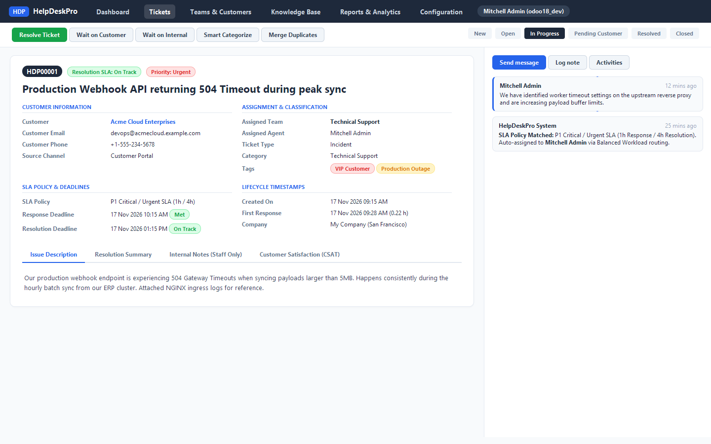
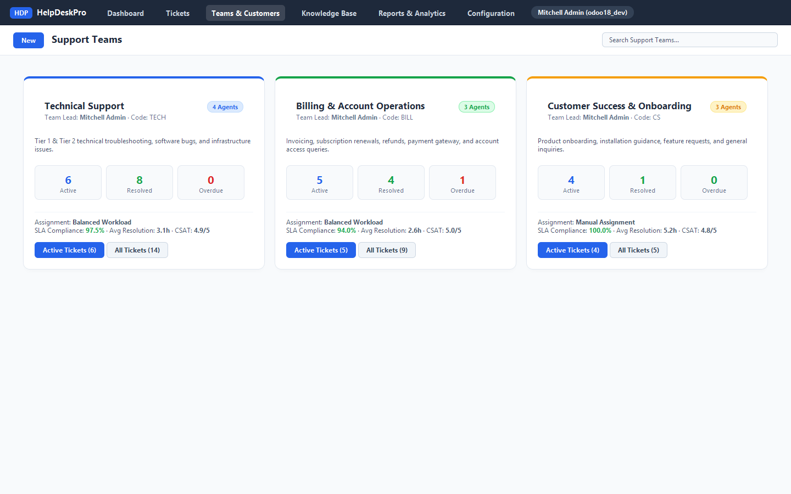
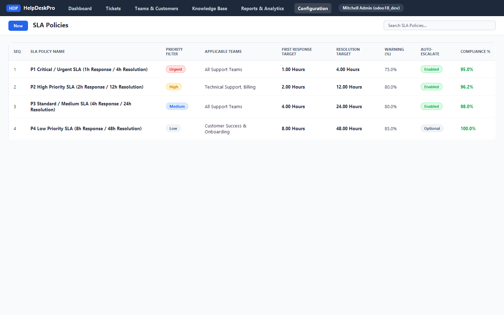
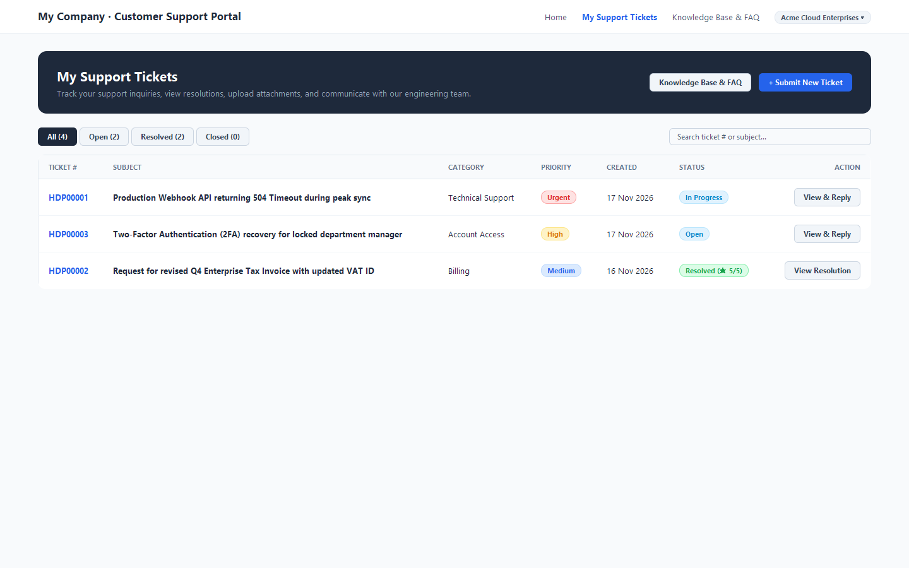
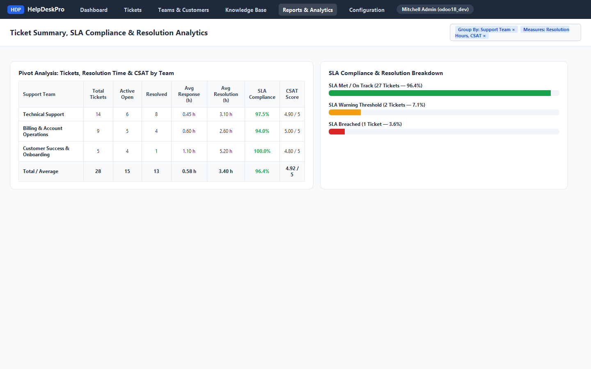

# HelpDeskPro – Intelligent Customer Support & Ticket Management System for Odoo 18


## 1. Project Introduction

**HelpDeskPro** (`helpdeskpro`) is a complete, production-quality Customer Support, Ticketing, Service Level Agreement (SLA), Knowledge Base, and Customer Portal application engineered for **Odoo 18 Community Edition**.

Designed with an enterprise Navy & Blue aesthetic (`#1E293B` / `#2563EB`), HelpDeskPro provides support organizations with end-to-end ticket lifecycle tracking, workload-balanced automatic agent assignment, real-time SLA breach monitoring and escalation, duplicate ticket detection and merging, a self-service Knowledge Base, and a secure Customer Portal.

---

## 2. Main Features

- **Interactive OWL Executive Dashboard:**
  - 10 dynamic, database-driven, clickable KPI cards (*Total Tickets*, *New*, *Open*, *In Progress*, *Resolved*, *Closed*, *Overdue*, *Unassigned*, *Avg Resolution Time*, and *SLA Compliance Rate*).
  - Dynamic filtering by **Date Range** (*Today*, *Last 7 Days*, *Last 30 Days*, *This Month*, *Last 90 Days*, *All Time*) and **Support Team**.
  - 5 visual charts (*Tickets by Status*, *Tickets by Priority*, *Tickets by Support Team*, *Tickets Created Over Time*, *Tickets Resolved Over Time*), plus *Priority & SLA Attention Queue* and *Agent Workload Leaderboard*.
- **Comprehensive Ticket Management (`helpdesk.ticket`):**
  - Automatic sequence generation (`HDP00001`).
  - 8 controlled workflow statuses (`New`, `Open`, `In Progress`, `Pending Customer`, `Pending Internal`, `Resolved`, `Closed`, `Cancelled`) with strict transition validation and reopen tracking.
  - 4 priority levels (`Low`, `Medium`, `High`, `Urgent`) and 5 ticket types (`Question`, `Incident`, `Problem`, `Service Request`, `Bug Report`).
- **Support Teams & Balanced Workload Routing (`helpdesk.team`):**
  - Multi-team architecture with Team Leaders, Team Members, and live performance KPIs.
  - Supports **Manual** or **Automatic – Least Active Workload** agent assignment.
- **Configurable SLA Engine (`helpdesk.sla`):**
  - Separate **First Response Target** and **Resolution Target** hours matched by Priority, Team, Category, and Ticket Type.
  - Real-time SLA statuses (`On Track`, `Warning`, `Breached`, `Completed`).
  - Scheduled cron automation (`_cron_evaluate_sla_and_escalate`) that automatically flags breached tickets, elevates priority, schedules follow-up activities, and escalates to the Team Leader.
- **Duplicate Detection & Ticket Merge Wizard:**
  - Automatically identifies potential duplicate tickets from the same customer with similar subjects.
  - Consolidates descriptions, attachments, tags, and followers into a primary destination ticket while preserving full audit history.
- **Smart Auto-Categorization & Knowledge Base (`helpdesk.knowledge.article`):**
  - Rule-based keyword classification out of the box (no paid API required).
  - Publishable FAQ and troubleshooting articles with live **Suggested Articles** shown as customers type a new ticket in the portal.
  - One-click **Publish Solution to Knowledge Base** directly from the Ticket Resolution Wizard.
- **Customer Portal (`/my/tickets` & `/helpdesk/knowledge`):**
  - Customers can submit tickets, upload attachments, reply to public threads, reopen resolved tickets, and submit **1–5 Star CSAT Ratings**.
  - Strict security isolation: customers can only access their own tickets, and `internal_notes` / private staff notes are never exposed.

---

## 3. Screenshots

### 3.1 Executive HelpDesk Dashboard


### 3.2 Ticket Kanban Board


### 3.3 Ticket Form & SLA Tracking


### 3.4 Support Team Management


### 3.5 SLA Policy Configuration


### 3.6 Customer Support Portal (`/my/tickets`)


### 3.7 Reports & SLA Compliance Analytics


---

## 4. Technology Stack

- **ERP Framework:** Odoo 18.0 Community Edition
- **Backend:** Python 3.11+, Odoo ORM
- **Frontend:** Odoo OWL 2 Component System, QWeb XML, ES6 JavaScript, CSS3
- **Database:** PostgreSQL 15+
- **Reporting:** QWeb PDF (`wkhtmltopdf`) & Native Pivot / Graph Analytics

---

## 5. Module Architecture

```text
helpdeskpro/
├── __init__.py
├── __manifest__.py
├── models/
│   ├── __init__.py
│   ├── helpdesk_ticket.py
│   ├── helpdesk_team.py
│   ├── helpdesk_category.py
│   ├── helpdesk_sla.py
│   ├── helpdesk_tag.py
│   ├── helpdesk_knowledge.py
│   └── res_partner.py
├── controllers/
│   ├── __init__.py
│   └── portal.py
├── wizard/
│   ├── __init__.py
│   ├── ticket_close_wizard.py
│   └── ticket_close_wizard_views.xml
├── security/
│   ├── helpdesk_security.xml
│   ├── ir.model.access.csv
│   └── record_rules.xml
├── data/
│   ├── sequence.xml
│   ├── mail_template.xml
│   ├── cron.xml
│   └── default_data.xml
├── views/
│   ├── menu_views.xml
│   ├── ticket_views.xml
│   ├── team_views.xml
│   ├── category_views.xml
│   ├── sla_views.xml
│   ├── knowledge_views.xml
│   ├── res_partner_views.xml
│   ├── dashboard_views.xml
│   └── portal_templates.xml
├── report/
│   ├── ticket_report.xml
│   └── ticket_templates.xml
├── static/src/
│   ├── css/helpdesk_dashboard.css
│   ├── js/helpdesk_dashboard.js
│   └── xml/helpdesk_dashboard.xml
├── tests/
│   ├── __init__.py
│   ├── test_ticket.py
│   ├── test_sla.py
│   ├── test_security.py
│   └── test_portal.py
├── demo/
│   └── demo_data.xml
├── screenshots/
├── README.md
└── LICENSE
```

---

## 6. Installation Instructions

1. Place the `helpdeskpro` directory inside your Odoo 18 `custom_addons` folder:
   ```text
   C:\odoo18\odoo-18.0\custom_addons\helpdeskpro
   ```
2. Ensure `custom_addons` is listed in `addons_path` inside `odoo.conf`:
   ```ini
   addons_path = C:\odoo18\odoo-18.0\odoo\addons,C:\odoo18\odoo-18.0\addons,C:\odoo18\odoo-18.0\custom_addons
   ```
3. Install the module via CLI or from the Odoo Apps menu:
   ```powershell
   .\.venv\Scripts\python.exe .\odoo-bin -c .\odoo.conf -d odoo18_dev -i helpdeskpro --stop-after-init
   ```
4. Start the Odoo server and open `http://localhost:8069`.

---

## 7. Configuration Instructions (Email / SMTP / IMAP)

- **Outgoing Email (SMTP):** Navigate to **Settings → Technical → Email → Outgoing Mail Servers** and configure your SMTP host, port, and credentials so automated ticket creation, assignment, and resolution notifications are delivered externally.
- **Incoming Email (IMAP/POP3):** Navigate to **Settings → Technical → Email → Incoming Mail Servers** and set **Actions to Perform on Incoming Mails → Create a New Record** (`helpdesk.ticket`) to automatically convert incoming support emails into tickets.

---

## 8. Security and User Roles

HelpDeskPro enforces a 5-tier role hierarchy via `ir.model.access.csv` and `ir.rule` record rules:

1. **HelpDesk User (`group_helpdesk_user`):** View permitted/own tickets and create support tickets.
2. **HelpDesk Agent (`group_helpdesk_agent`):** Access assigned, unassigned, and team tickets; communicate with customers; create KB articles.
3. **HelpDesk Team Leader (`group_helpdesk_leader`):** Manage team queues, assign agents, and view team analytics & reports.
4. **HelpDesk Manager (`group_helpdesk_manager`):** Full access to all tickets across teams, SLA policies, categories, and management analytics.
5. **HelpDesk Administrator (`group_helpdesk_admin`):** Full system administration and configuration access.

---

## 9. Usage Guide

- **Executive Dashboard:** Open **HelpDeskPro → Dashboard** to filter KPIs by date range or team and click any KPI card or chart bar to drill down into matching tickets.
- **Resolving Tickets & Publishing KB Articles:** Open a ticket and click **Resolve Ticket** to enter the Resolution Summary and optionally check **Publish Solution to Knowledge Base**.
- **Customer Portal:** Customers can visit `/my/tickets` to view their tickets, `/my/tickets/new` to submit a new request with live KB suggestions, and `/helpdesk/knowledge` to browse FAQs.

---

## 10. Testing Instructions

Run the automated test suite using the Odoo CLI:

```powershell
.\.venv\Scripts\python.exe .\odoo-bin -c .\odoo.conf -d odoo18_dev -u helpdeskpro --test-enable --stop-after-init --http-port=8079
```

---

## 11. Known Limitations & Future Improvements

- **Known Limitations:** Outgoing/incoming email delivery requires configuring an SMTP/IMAP server in Odoo Technical Settings.
- **Future Improvements:** Live chat (`im_livechat`) bridge, WhatsApp webhook integration, and timesheet billing integration.

---

## 12. License

Licensed under the **GNU Lesser General Public License v3.0 (LGPL-3)**. See [LICENSE](LICENSE) for full details.
